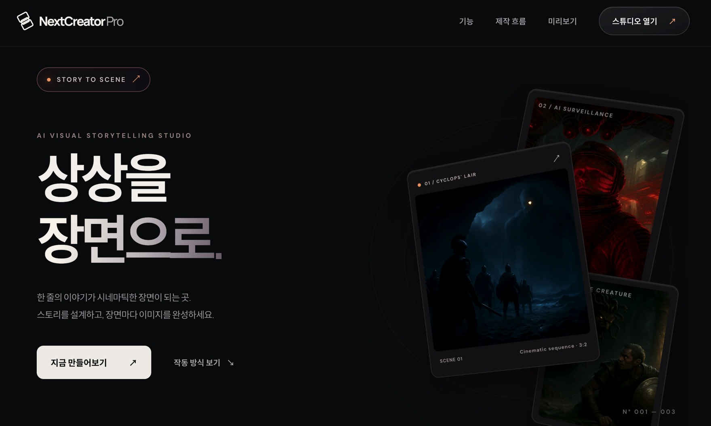

# NextCreator Pro 소개 페이지

한 줄의 이야기를 시네마틱한 장면으로 확장하는 AI 비주얼 스토리텔링 서비스, **NextCreator Pro**의 정적 랜딩 페이지입니다. 스토리 설계부터 장면 연출, 이미지 생성, 갤러리 확인까지의 흐름을 실제 제품 화면과 장면 예시로 소개합니다.

## 이번 작업의 주요 내용

- 히어로 영역의 추상 그래픽을 실제 시네마틱 장면이 담긴 플로팅 카드로 교체했습니다.
- 제작 흐름 섹션에 NextCreator Pro 갤러리 화면을 제품 프리뷰로 추가했습니다.
- 결과 섹션을 AI 감시, 키클롭스의 동굴, 괴물의 등장, 포세이돈의 분노 등 네 장면으로 구성했습니다.
- 원본 PNG 이미지를 WebP로 변환하고 크기를 조정해 화질을 유지하면서 페이지 전송 용량을 줄였습니다.
- 각 장면에 의미 있는 대체 텍스트와 캡션을 추가하고, 화면 아래쪽 이미지는 지연 로딩하도록 구성했습니다.
- 데스크톱에서는 4열, 태블릿에서는 2열, 모바일에서는 가로 스와이프 갤러리로 표시되도록 반응형 레이아웃을 보강했습니다.

## 오류 수정 및 안정화

- 페이지 설명과 실제 콘텐츠가 일치하지 않던 추상 플레이스홀더를 실제 결과 이미지로 교체했습니다.
- 서로 다른 비율의 이미지가 카드 밖으로 넘치거나 찌그러지지 않도록 `object-fit: cover`와 장면별 초점 위치를 적용했습니다.
- 모바일 갤러리의 스크롤 범위를 해당 컴포넌트 내부로 제한해 페이지 전체에 가로 스크롤이 생기지 않도록 했습니다.
- 데스크톱과 375px 모바일 화면에서 레이아웃을 확인했으며, 전체 이미지 8개가 누락 없이 로드되는 것을 검증했습니다.

## 실행

별도의 빌드나 패키지 설치 없이 `index.html`을 브라우저에서 열면 됩니다. 로컬 서버로 확인하려면 프로젝트 폴더에서 다음을 실행하세요.

```bash
python3 -m http.server 8000
```

그다음 `http://localhost:8000`에 접속합니다.

## 파일 구조

- `index.html`: 콘텐츠, 섹션, 외부 링크 및 접근성 구조
- `style.css`: 색상, 카드 표현과 반응형 레이아웃
- `app.js`: 제작 단계 탭과 모바일 메뉴 동작
- `assets/images/`: 제품 스크린샷과 최적화된 시네마틱 장면 이미지

외부 리소스는 Google Fonts뿐이며, 접속이 차단되면 시스템 글꼴로 대체됩니다.

## 수정하기

1. 제목·설명·버튼 문구는 `index.html`에서 편집합니다.
2. 색상은 `style.css` 맨 위의 `:root` 변수를 수정합니다.
3. 단계별 시연 문구는 `app.js`의 `steps` 배열에서 관리합니다.
4. 장면 이미지는 `assets/images/`에 추가한 뒤 `index.html`의 이미지 경로와 대체 텍스트를 갱신합니다.
5. 앱 주소가 변경되면 `index.html`의 `https://next-creator-pro.vercel.app/` 링크를 교체합니다.

## 배포

Vercel에서 이 GitHub 저장소를 연결하고 Framework Preset을 `Other`로 선택합니다. Build Command는 비워두고 Output Directory는 `.`으로 설정하면 됩니다. 별도 API, 비밀 키 또는 데이터베이스는 필요하지 않습니다.

## 확인 항목

- 데스크톱과 모바일에서 페이지 전체에 가로 스크롤이 없는지 확인
- 메뉴 버튼과 제작 단계 탭을 키보드로 조작할 수 있는지 확인
- 스튜디오·갤러리 버튼이 실제 앱으로 연결되는지 확인
- 이미지 로딩과 대체 텍스트를 확인
- 배포 후 메타 제목과 설명을 확인

참조: [NextCreator Pro Studio](https://next-creator-pro.vercel.app/studio) · [Gallery](https://next-creator-pro.vercel.app/gallery)
